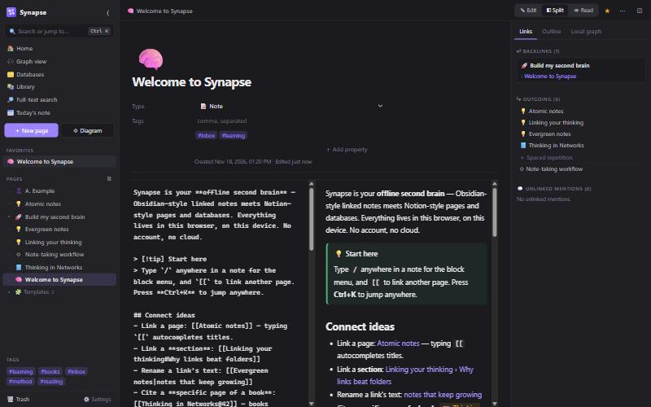
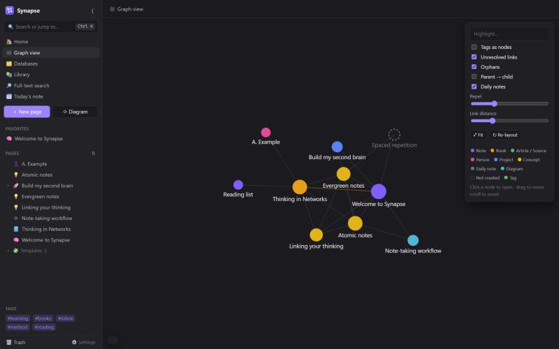
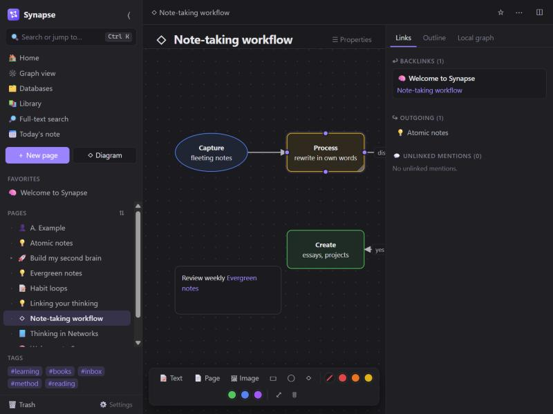
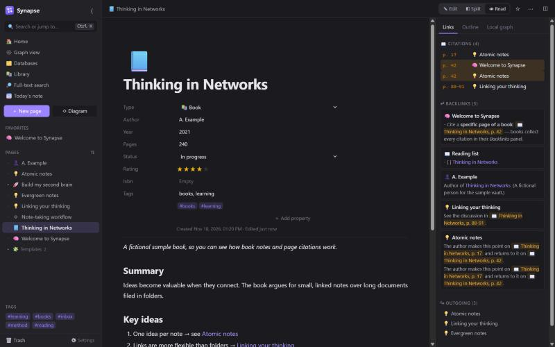

# 🧠 Synapse — an offline second brain

**▶ Live app: https://thebearlee.github.io/synapse/** (open it, then use your browser's *Install app* button to keep it offline)

Synapse is a local-first notes app that mixes **Obsidian-style linked thinking** with **Notion-style pages and databases**. It runs entirely in your browser with **no server, no account, no internet and no dependencies**. Your notes stay on your device.



## Features

### Connect ideas
- **Wiki links**: `[[Page]]`, with autocomplete as you type `[[`
- **Section links**: `[[Page#Heading]]` jumps to a specific heading
- **Aliases**: `[[Page|custom text]]`
- **Book & source citations**: `[[Book Title@42]]` links to page 42 of a book. Every book page lists its citations, sorted by page number.
- **Embeds / transclusion**: `![[Page]]`, `![[Page#Heading]]` or `![[Diagram]]` shows the other page inline
- **Backlinks**, **outgoing links** and **unlinked mentions** (one click turns a mention into a link)
- **Ghost links**: link to a page that doesn't exist yet, then click it to create it
- Renaming a page **updates every link** that points to it
- `#tags` and nested `#tags/subtags`
- Hover over any link to preview the page

### Visualize
- **Graph view**: a force-directed map of your whole vault. You can zoom, pan and drag nodes, hover to highlight neighbours, filter by type, and optionally show tags, unresolved links and the parent → child hierarchy.
- **Local graph**: the neighbourhood of the current page (depth 1–3) in the side panel
- **Diagrams (canvas)**: an infinite whiteboard with text cards, shapes (rectangle, ellipse, diamond), images, page cards and labelled arrows. Diagrams can be embedded in any note, and links on a diagram show up in the graph. Diagrams export to the open [JSON Canvas](https://jsoncanvas.org) format.




### Pages & databases (the Notion side)
- Nested pages (sub-pages), emoji icons, cover images and favorites
- **Page types** (note, book, article/source, person, project, concept, daily note, diagram, template), each with its own **properties** such as author, year, status and a star rating. You can also add custom properties.
- **Databases**: every page can be viewed as a sortable **table**, a drag-and-drop **kanban board** (by status) or a **gallery**. The 📚 **Library** is a ready-made database of your books.
- **Inline queries**: put a live database inside a note:

  ````
  ```query
  type:book status:"In progress" sort:-rating view:gallery
  ```
  ````

  Filters: `type:` `tag:` / `#tag` `status:` `links:"Page"` `sort:` `limit:` `view:table|list|board|gallery`, plus free text. Put `-` in front of a filter to exclude matches (for example `-type:daily`).



### Writing
- Markdown editor with **Edit / Split / Read** modes (Ctrl+E)
- `/` **slash menu**: headings, to-dos, callouts, toggles, tables, code, images, new diagram, citation, query, template…
- **Paste or drag images** straight into a note
- Callouts `> [!tip]`, collapsible toggles `> [!note]-`, highlights `==text==`, tables, task lists you can tick in preview
- **Daily notes** and **templates** (`{{date}}`, `{{title}}`, `{{time}}`)
- The home dashboard shows recent pages, open tasks from across the vault, an #inbox, orphan notes, and a random note to resurface

### Find things
- **Ctrl+K** quick switcher. Type `>` for commands and `#` for tags.
- Full-text search with highlighted matches

### Your data
- Stored in your browser's IndexedDB. It works offline and needs no account.
- **Export a backup** (`.json`, including images) and import it on another device
- **Export to Markdown**: a folder of `.md` files with YAML frontmatter, plus `attachments/` and `.canvas` files. It works with Obsidian.
- **Import Markdown** files (frontmatter becomes page properties)
- Trash with restore

> ⚠️ Clearing your browser's site data deletes your vault. Use **Settings → Make storage persistent** and export backups regularly.

## Getting started

**Option 1: just open it.** Download or clone the repo and open `index.html` in Chrome, Edge or Firefox. That's it.

**Option 2: serve it locally** (this also lets the app install as a standalone offline app):

```bash
python -m http.server 8000
```

Then open <http://localhost:8000>.

**Option 3: install it as an app.** Host the folder on any static host (for example GitHub Pages), open it, and use your browser's **Install app** button. After that the service worker keeps it working fully offline.

> Notes are stored per browser *and* per address. A vault opened from `file://` and one opened from `http://localhost` are separate, so use the backup export to move between them.

## Keyboard shortcuts

| Shortcut | Action |
| --- | --- |
| Ctrl/⌘ K | Search / jump to a page |
| Ctrl/⌘ Shift P | Command palette |
| Ctrl/⌘ N | New page |
| Ctrl/⌘ E | Cycle Edit / Split / Read |
| Ctrl/⌘ G | Graph view |
| Alt D | Today's daily note |
| Ctrl/⌘ \\ | Toggle sidebar |
| Ctrl/⌘ B / I / Shift H | Bold / italic / highlight |
| Ctrl/⌘ Enter | Toggle a to-do |
| `/` · `[[` | Block menu · link a page (`#` heading, `@` page number) |
| Canvas: double-click · drag a dot · Del · Ctrl D | New card · connect · delete · duplicate |

## Project structure

```
index.html          app shell
css/app.css         styles (light + dark)
js/util.js          helpers, modals, menus
js/db.js            IndexedDB storage
js/links.js         wiki-link / tag parsing, backlink index, rename refactoring
js/markdown.js      dependency-free Markdown renderer
js/editor.js        editor: autocomplete, slash menu, image paste
js/graph.js         force-directed graph (canvas)
js/canvas.js        diagram whiteboard
js/views.js         databases + query engine
js/pageview.js      page view, properties, embeds, connections panel
js/io.js            backup, Markdown/zip export, import
js/seed.js          sample vault shown on first launch
js/app.js           routing, sidebar, home, search, palette, settings
sw.js               offline cache (service worker)
```

No build step and no frameworks. Edit a file and reload the page.

## License

MIT
